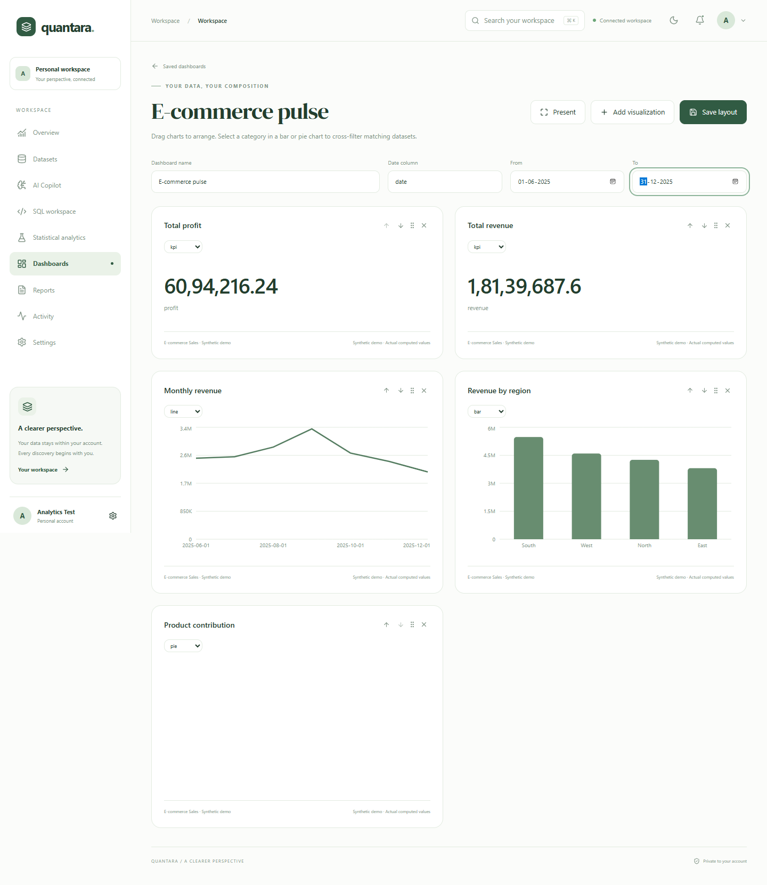
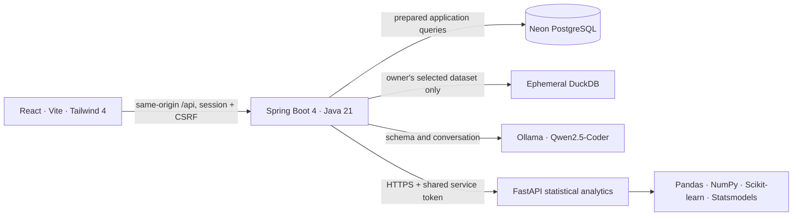

# QUANTARA

A conversational analytics workspace built around your data. The original forest-and-sage landing page, typography, gradients, and authentication layouts are preserved throughout the responsive application.



## What works

- Session-based signup, login, logout, protected routes, and account settings backed by Neon PostgreSQL.
- CSV/XLSX uploads, inferred schema, data completeness, duplicate counts, search, filters, sorting, and pagination.
- Exactly one optional **E-commerce Sales** synthetic demo per account: 750 fictional transactions. Reopening the demo reuses the existing dataset.
- Isolated read-only DuckDB SQL, saved queries, history, and per-user dataset ownership.
- Ollama **Qwen2.5-Coder** schema-grounded SQL drafts, streaming, conversational follow-ups, explicit query review, chart suggestions, result interpretations, and user-controlled correction.
- Saved dashboard templates, draggable widgets, keyboard reordering, date filters, cross-filtering, presentation view, and bar, line, area, pie, scatter, heatmap, table, and KPI widgets.
- CSV/PDF reports, onboarding, global search, notifications, activity, usage statistics, and persistent appearance preferences.
- A private Python FastAPI statistical service: real IsolationForest anomaly detection, regression trends, Statsmodels forecasts, 95% prediction intervals, and temporal evaluation metrics.

## Architecture



Java remains the primary backend. Browser clients never receive database credentials or the ML service secret. User SQL executes against a fresh in-memory table containing only the selected, authorized dataset; it never executes against the Neon owner connection.

## Run locally on Windows

Prerequisites: Java 21, Node.js 22+, Python 3.14, a Neon database, and Ollama for AI features.

```powershell
# Install frontend dependencies.
cd frontend
npm.cmd ci
cd ..

# Install the lightweight statistical service.
cd ml-service
python -m venv .venv
.\.venv\Scripts\python.exe -m pip install -r requirements-dev.txt
cd ..

# Download the model once and keep Ollama running.
ollama pull qwen2.5-coder:3b

# Start Spring Boot. Enter the Neon password at the hidden prompt.
cd backend
.\start-local.ps1 -DatabaseUrl 'jdbc:postgresql://YOUR_NEON_HOST/neondb?sslmode=require&channelBinding=require' -DatabaseUsername neondb_owner
```

The launcher starts `mvnw.cmd spring-boot:run`, supplies database credentials only to the child process, and starts the local Python service on `127.0.0.1:8001` when its virtual environment exists. It generates a random shared ML token for that session and stops its own Python child on exit. Embedded URL credentials and conflicting datasource/Flyway overrides are rejected.

In another terminal:

```powershell
cd frontend
npm.cmd run dev
```

Open `http://localhost:5173`, sign up, and choose **Explore E-commerce demo** or upload your own file. No default passwords or shared demo account exist.

`GET http://localhost:8080/actuator/health` and `GET http://localhost:8080/api/auth/csrf` are public. Workspace APIs require a signed-in session. All mutations, including login and signup, require the CSRF token returned by the CSRF endpoint.

## Statistical interpretation

Actual observations and predicted values occupy separate fields. Forecasts are never inserted into source datasets. Missing periods may be interpolated for modeling, but displayed actuals remain missing and are marked accordingly.

Candidate models are selected using an earlier validation window. Final MAE, RMSE, sMAPE, baseline MAE, and empirical interval coverage use a separate trailing holdout. Training interpolation does not use future held-out observations, and missing test actuals are excluded. The forecast then refits the selected model on the available historical series. Anomalies indicate unusual observations; they do not establish fraud or causality. Confidence intervals depend on model assumptions and do not guarantee outcomes.

## Limits and safeguards

- Uploads: 5 MB, 10,000 rows, 50 columns, 10,000 characters per cell; first XLSX worksheet only.
- SQL: one SELECT/WITH statement, 500 returned rows, 8-second execution cancellation, bounded concurrency, external readers/extensions disabled, 64 MB DuckDB memory per query.
- ML: 20–10,000 input rows, 20–2,000 aggregated periods, maximum 60-period horizon, at most 20% missing periods, bounded worker capacity.
- Authentication uses BCrypt and HttpOnly sessions; production sessions require HTTPS. CSRF and explicit CORS allowlists remain enabled.
- Fixed-window API limits cover auth, queries, AI, ML, and general requests. Limits are per process and reset on restart; this Free single-instance setup does not claim distributed rate limiting.
- Existing Flyway migrations are preserved. New migrations add workspace functionality; Flyway clean is disabled.

See [deployment and free-tier constraints](docs/deployment.md), [API reference](docs/api.md), [design system](docs/design-system.md), and [verification](docs/verification.md).

## Checks

```powershell
cd backend
.\mvnw.cmd -B verify
cd ..\ml-service
.\.venv\Scripts\python.exe -m pytest -q
cd ..\frontend
npm.cmd run build
npm.cmd run lint
# With the backend, ML service, Ollama, and frontend on port 5173 running:
npx.cmd playwright test
```

Unit tests do not require production database credentials. The optional full-context database test runs only when `DATABASE_PASSWORD` is supplied. Browser tests use unique test accounts and actual API operations. They never delete pre-existing database data.
