<div align="center">

## 📈 QUANTARA

### Your data. Your questions. Clearer decisions.

**A conversational AI analytics workspace for exploring datasets, generating safe SQL, building interactive dashboards, and uncovering explainable statistical insights.**

<p>
  
  
  
  
  
  
</p>

**QUANTARA** turns uploaded data into an interactive analytics experience. Upload a CSV or Excel workbook, inspect its structure, ask questions in natural language, review generated SQL before running it, visualize results, and save dashboards and reports.

The product retains its original **forest-and-sage landing-page identity** across authentication, dashboards, and analytics workspaces: soft gradients, considered typography, refined components, and responsive layouts.

### At a glance

| | Capability | What it delivers |
|:--:|---|---|
| 🗂️ | **Dataset workspace** | CSV/XLSX uploads, previews, profiling, filtering, and cleaning suggestions |
| 💬 | **AI analytics copilot** | Schema-aware natural-language-to-SQL drafts and conversational follow-ups |
| 🛡️ | **Controlled SQL execution** | Explicit review, read-only queries, dataset isolation, and resource limits |
| 📊 | **Dashboard studio** | Draggable widgets, charts, KPI cards, filters, and saved layouts |
| 📈 | **Statistical intelligence** | Anomaly detection, trends, forecasts, and evaluation metrics |
| 📄 | **Reporting** | Exportable CSV/PDF reports and presentation-ready dashboards |
| 🔐 | **Personal workspace** | Sessions, user-owned datasets, settings, activity, and usage insights |

---

## 🧭 Table of Contents

- [Features](#-features)
- [Product Experience](#-product-experience)
- [Workspace Navigation — Every Sidebar Page](#-workspace-navigation--every-sidebar-page)
- [Technology Stack](#-technology-stack)
- [Technology Deep Dive](#-technology-deep-dive--why-every-tool-exists)
- [End-to-End User Journeys](#-end-to-end-user-journeys)
- [Architecture Decisions & Security](#-architecture-decisions-and-security-boundaries)
- [Deployment Explained](#-deployment-explained--from-laptop-to-live-application)
- [Reading the Repository](#-reading-the-repository-like-an-engineer)
- [Mermaid Rendering Guide](#-mermaid-diagrams--github-rendering-guide)
- [System Architecture](#-system-architecture)
- [How QUANTARA Works](#-how-quantara-works)
- [Project Structure](#-project-structure)
- [Getting Started](#-getting-started)
- [AI and Statistical Analytics](#-ai-and-statistical-analytics)
- [Security and Limits](#-security-and-limits)
- [Testing and Verification](#-testing-and-verification)
- [Deployment](#-deployment)
- [Documentation](#-documentation)
- [Project Status](#-project-status)

---

## 🚀 Features

### 01 / Identity & workspace

- Session-based signup, login, logout, protected routes, and account settings.
- User-specific dataset, query, and dashboard access backed by Neon PostgreSQL.
- CSRF protection for state-changing requests; secure production session configuration.
- Onboarding, activity history, notifications, usage insights, and saved appearance preferences.

### 02 / Dataset intelligence

- Upload **CSV** and **XLSX** files with validation and inferred column types.
- Inspect previews, completeness, duplicates, and dataset metadata.
- Search, filter, sort, and paginate records.
- Explore schema information and suggested data-cleaning actions.
- Open a single optional **E-commerce Sales** demo dataset per account, containing **750 fictional transactions**; reopening reuses the existing demo.

### 03 / Conversational AI analytics

- Ask business questions in natural language.
- Draft SQL using **Ollama + Qwen2.5-Coder**, grounded in the selected dataset schema.
- Review generated SQL before execution; continue with follow-up questions.
- Explain SQL, propose chart types, interpret results, and request corrections.
- Stream AI responses where supported.
- Keep generated explanations grounded in actual query results rather than invented metrics.

### 04 / Visual analytics studio

- Save multiple dashboards and start from templates.
- Arrange draggable widgets; use keyboard reordering for accessibility.
- Visualize data through **bar, line, area, pie, scatter, heatmap, table, and KPI** widgets.
- Apply date filters, cross-filtering, and chart customizations.
- Switch to presentation view and export **CSV/PDF** reports.

### 05 / Statistical ML service

- **IsolationForest** for anomaly detection.
- Regression-based trend analysis.
- **Statsmodels** time-series forecasting.
- 95% prediction intervals and temporal evaluation metrics.
- Separate observed data from forecasts and label missing observations explicitly.

---

## 🎨 Product Experience

| Surface | Experience |
|---|---|
| **Landing page** | Original forest-and-sage gradients, editorial typography, premium motion |
| **Authentication** | Matching visual language with secure signup and login |
| **Overview dashboard** | KPI summaries, activity, navigation, and analytics entry points |
| **Datasets** | Upload, profile, preview, search, and manage data |
| **AI Copilot** | Natural-language questions, SQL review, and evidence-based answers |
| **Dashboard Studio** | Reusable charts, draggable layouts, date filtering, and presentation mode |
| **Statistics** | Forecasts, anomalies, model diagnostics, and uncertainty |
| **Settings** | Profile, preferences, activity, and usage information |

<!-- After deployment, replace these optional placeholders with real screenshots. -->
<!-- Example:  -->

> **Design principle:** A consistent, calm analytics environment—not a collection of disconnected admin templates.

---

## 🧭 Inside the Workspace — Explore Every Sidebar Section

> **Live workspace:** [Open QUANTARA](https://quantara-neon.vercel.app/app) · **Sign-in required** for protected workspace pages. Links below identify the published routes; production behavior depends on the availability of the backend and AI/ML services.

The **left sidebar** is QUANTARA's main navigation system. It keeps the same forest-and-sage styling across the product, with a highlighted active destination, simple line icons, and a persistent workspace identity. The navigation leads from data ingestion through AI-assisted exploration to visual dashboards and downloadable reports.

### 🧭 Sidebar navigation at a glance

| Navigation | Live page | Purpose | Key actions |
|---|---|---|---|
| 📊 **Overview** | [Open overview](https://quantara-neon.vercel.app/app) | At-a-glance analytics home | Inspect KPIs, recent activity, jump into workflows |
| 🗂️ **Datasets** | [Open datasets](https://quantara-neon.vercel.app/app/datasets) | Dataset library and profiling | Upload, preview, filter, inspect quality |
| 🧠 **AI Copilot** | [Open AI Copilot](https://quantara-neon.vercel.app/app/copilot) | Natural-language analytics | Ask questions, inspect SQL drafts, follow up |
| 💻 **SQL workspace** | [Open SQL workspace](https://quantara-neon.vercel.app/app/queries) | Controlled SQL exploration | Validate, execute, save and revisit queries |
| 📈 **Statistical analytics** | [Open statistics](https://quantara-neon.vercel.app/app/statistics) | Data science and forecasting | Detect anomalies, analyze trends, evaluate forecasts |
| 📉 **Dashboards** | [Open dashboards](https://quantara-neon.vercel.app/app/dashboards) | Custom visualization studio | Arrange widgets, filter, present and save |
| 📄 **Reports** | [Open reports](https://quantara-neon.vercel.app/app/reports) | Exportable analytics | Generate CSV/PDF reports |
| 🕒 **Activity** | [Open activity](https://quantara-neon.vercel.app/app/activity) | Workspace history | Review recorded actions and usage |
| ⚙️ **Settings** | Account settings (sidebar) | Profile and preferences | Manage account and appearance |

```text
╭──────────────────────────────────────────────╮
│   ✦  Q U A N T A R A                        │
│      Your perspective, connected             │
├──────────────────────────────────────────────┤
│   W O R K S P A C E                          │
│                                              │
│   ▥  Overview             /app               │
│   ▤  Datasets             /app/datasets      │
│   ✧  AI Copilot           /app/copilot       │
│   </> SQL workspace       /app/queries       │
│   ⚗  Statistical analytics /app/statistics   │
│   ▦  Dashboards           /app/dashboards    │
│   ▤  Reports              /app/reports       │
│   ≋  Activity             /app/activity      │
│   ⚙  Settings             Account controls   │
│                                              │
│   A clearer perspective.                     │
╰──────────────────────────────────────────────╯
```

### 01 / 📊 Overview — The analytics command center

**[Explore Overview →](https://quantara-neon.vercel.app/app)**

The first screen after authentication is designed to answer **“What is happening in my analytics workspace?”** It consolidates workspace-level indicators, charts and entry points into one place rather than requiring users to open every dataset separately.

- **KPI overview:** Quickly inspect available business measures and workspace summaries derived from accessible data.
- **Analytics snapshots:** Use compact visualizations to identify patterns before opening a detailed dashboard.
- **Recent activity:** Resume work from recent dataset, query or reporting interactions when recorded.
- **Quick navigation:** Move directly to uploading a dataset, asking the Copilot a question, or building a dashboard.
- **Personal workspace:** Content is associated with the signed-in user; empty states guide first-time users.

**Typical flow:** Sign in → Review the overview → Select a dataset → Open an analytics tool.

### 02 / 🗂️ Datasets — The foundation of every insight

**[Explore Datasets →](https://quantara-neon.vercel.app/app/datasets)**

The dataset library is where raw files become structured, inspectable analytics assets. QUANTARA supports **CSV/XLSX uploads** and an optional **E-commerce Sales** sample containing **750 fictional transactions**, with only one demo copy per account.

- **Import and validate:** Check supported formats, file size, dimensions, and content constraints.
- **Automatic profiling:** Infer column types; surface missing values, completeness and duplicate counts.
- **Interactive table:** Preview records using pagination, sorting, filtering and search.
- **Schema intelligence:** Inspect field names, data types, and dataset metadata before querying.
- **Data-quality guidance:** Identify potential cleaning needs without silently modifying source data.
- **Ownership boundaries:** Access and analysis are restricted to the signed-in user's datasets.

**Typical flow:** Upload CSV/XLSX → Inspect quality → Review schema → Select the dataset for SQL, Copilot, or statistics.

### 03 / 🧠 AI Copilot — Ask questions instead of writing SQL

**[Explore AI Copilot →](https://quantara-neon.vercel.app/app/copilot)**

The conversational workspace turns plain-English questions into **schema-aware SQL drafts** using **Ollama + Qwen2.5-Coder** in local development. It is intended to keep the user in control: SQL is displayed for review before analysis is executed.

- **Natural-language questions:** Ask questions such as *“Which region generated the most revenue?”*
- **Schema grounding:** Construct drafts using the selected dataset's real columns.
- **SQL transparency:** Inspect the query instead of accepting a hidden model-generated calculation.
- **Conversational follow-ups:** Refine questions with context from the current analysis.
- **Chart recommendations:** Suggest suitable visual forms for returned results.
- **Explanations and correction:** Explain the draft and support user-controlled revisions.
- **Streaming:** Display incremental responses when the active AI provider supports them.

**Typical flow:** Choose dataset → Ask question → Review SQL → Run approved analysis → Interpret results → Create a chart.

> **Production note:** The live frontend route does not by itself establish that hosted AI inference is available. Local Ollama cannot be reached from cloud services unless a compatible accessible inference endpoint is configured.

### 04 / 💻 SQL workspace — Explore data with transparent queries

**[Explore SQL Workspace →](https://quantara-neon.vercel.app/app/queries)**

The SQL workspace gives users a reproducible path from an analytical question to actual query results. Rather than exposing the application database, QUANTARA evaluates authorized dataset content in an **isolated, in-memory DuckDB** context.

- **Read-only querying:** Accept controlled `SELECT` / `WITH` queries, not database mutations.
- **Query inspection:** Review generated SQL and write custom analytical queries.
- **Results table:** Inspect returned rows and use results in subsequent analysis.
- **Saved queries:** Reuse frequently requested calculations.
- **Query history:** Return to earlier analyses and refine them.
- **Safety controls:** Single-statement restrictions, result caps, timeouts and resource bounds.

**Typical flow:** Select dataset → Draft or paste SQL → Validate → Execute → Review result → Save query.

### 05 / 📈 Statistical analytics — Evidence beyond the language model

**[Explore Statistical Analytics →](https://quantara-neon.vercel.app/app/statistics)**

This section uses a **Python FastAPI statistical service** for calculations that should not be improvised by a language model. The service combines **Pandas, NumPy, scikit-learn, and Statsmodels** to compute real statistical outputs.

- **Anomaly detection:** Use IsolationForest to flag unusual observations for investigation.
- **Trend analysis:** Estimate directional patterns with regression-based techniques.
- **Forecasting:** Model future periods using historical series and appropriate assumptions.
- **Uncertainty display:** Show prediction intervals separately from actual observations.
- **Model evaluation:** Report MAE, RMSE, sMAPE and other available temporal holdout measures.
- **Interpretation:** Explain what the metrics do—and do not—establish.

**Typical flow:** Select dataset and time/value fields → Choose analysis → Run model → Inspect evidence and uncertainty → Use findings in reports.

> **Interpretation:** Anomalies are not proof of fraud; forecasts are estimates, not guaranteed outcomes. Production ML requires the Python service to be reachable by the backend.

### 06 / 📉 Dashboards — Design your own analytics story

**[Explore Dashboards →](https://quantara-neon.vercel.app/app/dashboards)**

The dashboard builder is QUANTARA's visual studio. The provided screenshot shows a saved demo dashboard titled **“E-commerce pulse”**, using the original forest-and-sage styling, spacious cards and a persistent left sidebar.

**Visible dashboard controls and their roles:**

| UI element | What users can do |
|---|---|
| **Dashboard name** | Name and identify a saved analytics composition, e.g. *E-commerce pulse*. |
| **Date column** | Choose the date field used to filter the displayed dataset. |
| **From / To** | Narrow the time range for supported widgets. |
| **Total profit** | View an aggregated profit KPI for the selected synthetic data. |
| **Total revenue** | View an aggregated revenue KPI for the selected synthetic data. |
| **Monthly revenue** | Follow a time-based revenue trend in a line chart. |
| **Revenue by region** | Compare regional revenue in a bar chart. |
| **Chart type dropdown** | Switch between compatible visualizations for a widget. |
| **Reorder controls** | Move widgets to adjust the composition. |
| **Remove control** | Remove an unwanted visualization. |
| **Add visualization** | Add new KPIs, charts, or tables. |
| **Present** | Switch to a cleaner, presentation-focused display. |

**Additional visualization capabilities:**

- **Widget library:** KPI, bar, line, area, pie, scatter, heatmap and table views.
- **Customizable layouts:** Arrange and reorder visual blocks, including keyboard-based controls where supported.
- **Cross-filtering:** Use supported selections to narrow related charts.
- **Saved dashboards:** Keep multiple dashboard compositions for different analytical questions.
- **Templates:** Start from an existing composition instead of a blank canvas.
- **Report-ready views:** Present results clearly and export supported outputs.

**Typical flow:** Open dashboard → Select dataset/date range → Add visualizations → Reorder and customize → Save → Present or export.

> **Screenshot note:** The E-commerce Sales dataset is synthetic. Displayed revenue and profit are calculated demo values, not real business financial results.

### 07 / 📄 Reports — Turn exploration into shareable output

**[Explore Reports →](https://quantara-neon.vercel.app/app/reports)**

Reports turn on-screen analysis into artifacts that can be shared or revisited outside the application.

- **CSV export:** Download structured query results for further spreadsheet analysis.
- **PDF export:** Produce a formatted document suitable for reviewing insights or presenting summaries.
- **Context-aware output:** Reflect the selected dataset and supported filters rather than unrelated placeholder figures.
- **Clear interpretation:** Distinguish historical observations, computed summaries, and model forecasts.

**Typical flow:** Complete analysis → Choose export format → Generate report → Download and share.

### 08 / 🕒 Activity — Your workspace timeline

**[Explore Activity →](https://quantara-neon.vercel.app/app/activity)**

Activity provides continuity between sessions by showing recorded workspace interactions and usage information.

- **Activity timeline:** Revisit recorded dataset, query, dashboard or report actions.
- **Notifications:** Surface supported workspace updates and feedback.
- **Usage insights:** Understand how analytics tools are used within the account.
- **Context:** Help users locate recent work without treating the activity page as a comprehensive security audit log.

**Typical flow:** Open activity → Locate a recent operation → Return to the relevant workspace section.

### 09 / ⚙️ Settings — Account and workspace preferences

The **Settings** destination is visible in the sidebar screenshot. It is the home for personal configuration and should remain consistent with QUANTARA's forest-and-sage interface.

- **Account profile:** Review and update supported account information.
- **Appearance:** Save supported visual preferences, including theme choices.
- **Session-aware settings:** Keep preferences associated with the authenticated user.
- **Consistent interface:** Maintain the same typography, spacing and controls used elsewhere in the product.

### 🔄 From the sidebar to a finished insight

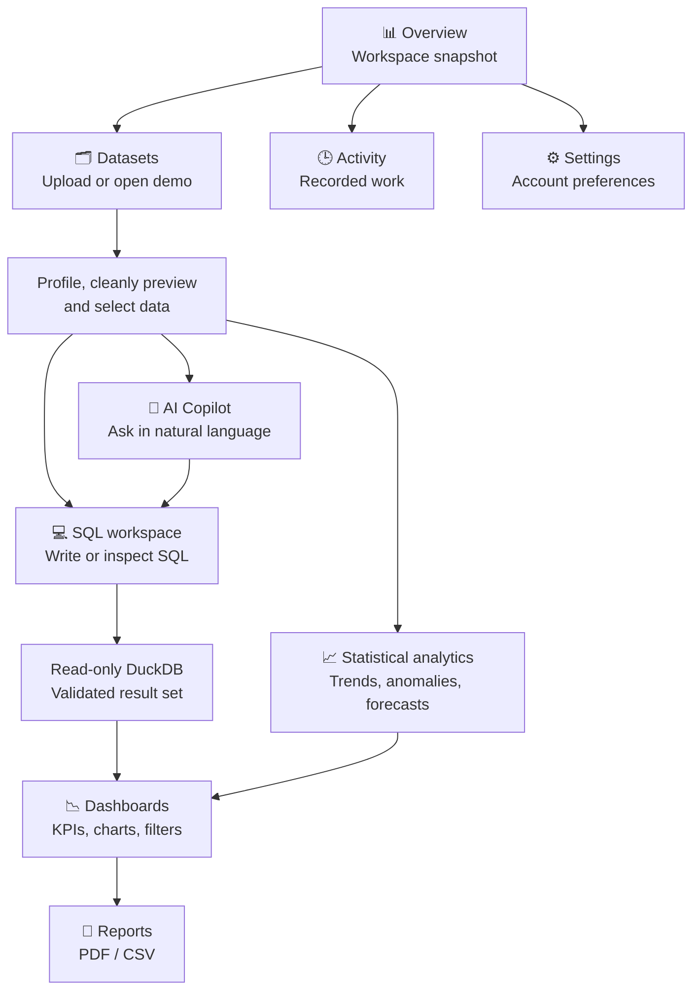

**One connected workflow:** **Upload → Understand → Ask → Query → Analyze → Visualize → Export.**

---

## 🛠️ Technology Stack

| Layer | Technologies | Role |
|---|---|---|
| **Frontend** | React, Vite, TypeScript | Fast, typed single-page application |
| **Styling** | Tailwind CSS v4 | Responsive design system and styling |
| **Charts** | Recharts | Interactive charts and KPI visualizations |
| **Backend** | Java 21, Spring Boot 4, Spring Web | Primary API and application logic |
| **Persistence** | Spring Data JDBC, Flyway | Database access and versioned migrations |
| **Primary database** | Neon PostgreSQL | Accounts, sessions, workspace metadata |
| **Analytics SQL** | DuckDB | Isolated, in-memory, read-only dataset querying |
| **Local LLM** | Ollama, Qwen2.5-Coder 3B | Schema-grounded SQL drafting and explanations |
| **ML API** | Python, FastAPI | Private statistical analysis service |
| **ML & statistics** | Pandas, NumPy, scikit-learn, Statsmodels | Profiling, anomalies, trends, forecasts |
| **Testing** | Maven tests, pytest, Playwright | Backend, ML, and browser verification |
| **Frontend hosting** | Vercel | Production frontend target |
| **Backend hosting** | Render Free (where supported) | Production backend/ML targets |

### Why this architecture?

The **Spring Boot API** owns authentication, authorization, and application data. **DuckDB** executes restricted analytical queries against only the user's selected dataset. **Ollama** proposes SQL and explanations, while the **FastAPI** service performs actual statistical computations. This separates language generation from numerical modeling and protects the primary PostgreSQL connection from arbitrary user SQL.

---


## 🧬 Technology Deep Dive — Why Every Tool Exists

QUANTARA uses different technologies for different jobs. The browser renders the workspace; Java protects and coordinates application data; DuckDB performs analytical SQL; the language model translates intent into a query draft; Python computes statistical results. Keeping those responsibilities separate makes the system easier to test and reason about.

### ⚛️ React — the interactive application layer

- **React** renders reusable interface components such as dataset tables, KPI cards, forms, charts, and dialogs.
- The application is organized into route-level pages, shared components, hooks, and API-facing services.
- Client-side state tracks selected datasets, dashboard configuration, and transient interaction state.
- Protected workspace pages depend on server-validated sessions; hiding a route in React is **not** authorization.
- The browser presents AI suggestions as drafts and keeps SQL execution as an explicit user action.

### ⚡ Vite — frontend tooling

- **Vite** runs the fast local development server and bundles the frontend for production.
- During development, frontend API requests can be proxied to Spring Boot to keep a consistent `/api` contract.
- In production, routing and API forwarding must be configured so session cookies and CSRF work correctly.
- `npm run build` checks that the production frontend can be generated; it does not prove the deployed API is reachable.

### 🔷 TypeScript — predictable contracts

- TypeScript adds compile-time checks to component props, request payloads, and API response shapes.
- It helps avoid mismatches between chart data, dataset columns, and visualization configurations.
- Runtime input still needs validation on the server: TypeScript types do not sanitize uploaded files or SQL.

### 🌿 Tailwind CSS v4 — the forest-and-sage design language

- Utility classes provide consistent spacing, responsive layouts, borders, and visual states.
- Shared tokens preserve the original landing page's typography, gradients, soft green accents, and restrained cards.
- The same visual system is carried through authentication, side navigation, datasets, and analytics pages.
- Loading, empty, error, focus, and keyboard states are part of the design—not afterthoughts.

### 📊 Recharts — data visualization

- Recharts builds interactive chart components from computed result sets.
- Charts consume **real** query results or statistical-service output; they do not generate business numbers.
- Chart configuration controls axes, labels, selected metrics, grouping, and presentation.
- Bar, line, area, pie, and scatter views complement custom table, KPI, and heatmap widgets.
- The dashboard layer coordinates filters, saved layouts, and chart-specific settings.

### ☕ Java 21 — the application foundation

- Java provides a strongly typed runtime for security-sensitive application logic.
- The backend is the authority for session identity, dataset ownership, and permissible operations.
- Backend services orchestrate database access, analytical queries, AI requests, and ML calls.
- Java is **not** used to train the forecasting models; that work belongs to the Python service.

### 🍃 Spring Boot 4 — the primary API

- **Spring Web** exposes the HTTP endpoints consumed by the React application.
- Authentication and session handling enforce account-level boundaries on protected APIs.
- Request validation rejects invalid input before it reaches storage or query execution.
- Application services decide whether a dataset is owned by the current user.
- Backend integrations invoke DuckDB, Ollama, and the private ML service with bounded requests.
- Health endpoints support readiness and deployment checks.
- Spring Boot coordinates the product; it is not merely a pass-through to an LLM.

### 🗄️ Spring Data JDBC — persistence without JPA

- **Spring Data JDBC** maps application aggregates to PostgreSQL tables.
- It keeps persistence explicit and avoids relying on JPA/Hibernate behavior.
- Repository operations manage user-owned records such as datasets, saved queries, and dashboard metadata.
- Database schema evolution is managed separately through **Flyway** migrations.
- Existing historical migrations should remain immutable once applied.

### 🐘 Neon PostgreSQL — durable workspace data

- Neon stores persistent application data in PostgreSQL.
- This includes user/account information and metadata needed to reopen saved workspaces.
- Application queries use authorized backend access, not browser-side database credentials.
- Per-user access checks are required even when a record identifier is known.
- Neon is **not** the target of arbitrary AI-generated analytical SQL.

### 🦆 DuckDB — isolated analytical SQL

- DuckDB is an analytical database engine used for bounded queries over the selected dataset.
- The backend materializes only an authorized dataset into a fresh, in-memory query context.
- SQL is constrained to supported read-only forms such as a single `SELECT` or `WITH` query.
- Limits on rows, time, memory, and concurrency help prevent runaway analysis.
- External readers and extensions are disabled in the described query environment.
- Separating DuckDB from Neon protects the application database from arbitrary analytics SQL.

### 🦙 Ollama — local model serving

- Ollama runs the selected model on a developer machine during local development.
- QUANTARA uses **Qwen2.5-Coder 3B** to propose SQL based on the dataset schema and conversation.
- The model can explain a query, suggest visualizations, and describe returned results.
- It does **not** have permission to execute SQL directly or modify the production database.
- The user reviews a draft before it enters the guarded execution path.
- Production use requires a separately accessible inference endpoint; local `localhost` is not a public AI service.

### 🧠 Qwen2.5-Coder — language-to-query assistance

- Input: the user's question, selected schema, and relevant conversation context.
- Output: a proposed SQL statement or explanatory text.
- Validation: the Java backend checks the generated statement against execution policy.
- Correction: invalid drafts can be revised, but must pass validation again.
- Interpretation: explanations should cite actual returned values rather than fabricate totals or trends.
- Generated SQL is a **proposal**, not a trusted command.

### 🐍 Python + FastAPI — numerical intelligence

- **FastAPI** exposes private endpoints for statistical analysis.
- **Pandas** prepares tabular data and time-indexed series.
- **NumPy** supports efficient numerical calculations.
- **scikit-learn** provides IsolationForest and regression-related algorithms.
- **Statsmodels** supplies time-series forecasting methods.
- The service receives bounded, authorized data from Spring Boot, not direct user credentials.
- ML predictions and uncertainty are computed by statistical code rather than invented by the LLM.

### 🧪 Test and delivery tooling

| Tool | Responsibility | What success means |
|---|---|---|
| **Maven Wrapper** | Compile and test Spring Boot | Backend verification command passes |
| **pytest** | Test Python analytics | Numerical behavior and endpoint tests pass |
| **Playwright** | Browser end-to-end journeys | User-facing flows work against running services |
| **ESLint** | Frontend static checks | Configured lint rules pass |
| **GitHub Actions** | CI automation | Defined workflows complete successfully |
| **Vercel** | Frontend hosting | Site serves the built React application |
| **Render** | Backend/ML hosting target | Deployed services start and pass health checks |
| **Neon** | Managed PostgreSQL | Backend can connect and apply migrations safely |

---

## 🧭 End-to-End User Journeys

### Journey A — first-time account to dashboard

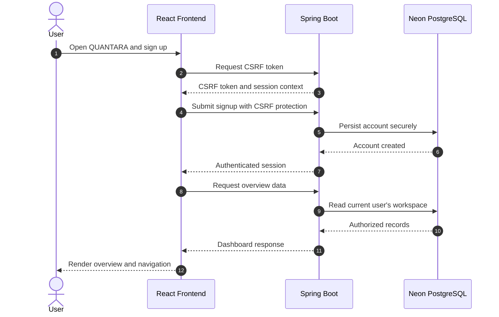

**Why it matters:** The server, not the sidebar, decides which user's data is returned.

### Journey B — dataset upload and profiling

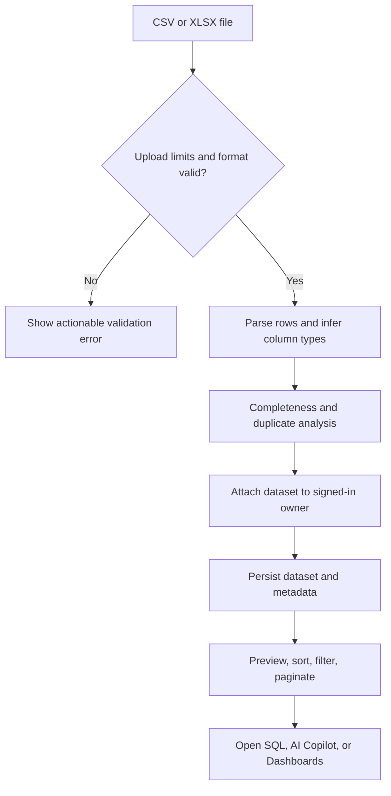

**Supported inputs:** CSV and the first worksheet of an XLSX workbook, subject to configured limits.

### Journey C — AI Copilot to a validated SQL result

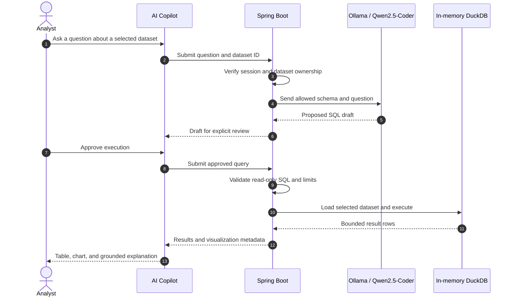

**Safety invariant:** An LLM-generated statement must never bypass authorization or SQL validation.

### Journey D — statistical forecasting

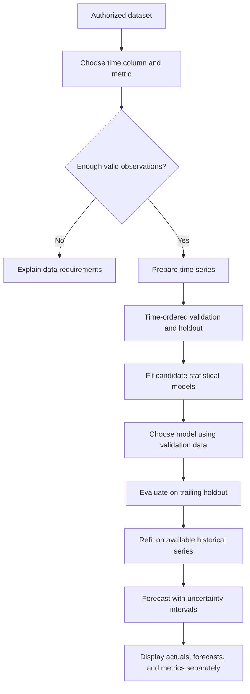

**Interpretation:** Forecasts are estimates; prediction intervals reflect assumptions and do not guarantee future outcomes.

### Journey E — dashboard creation and report export

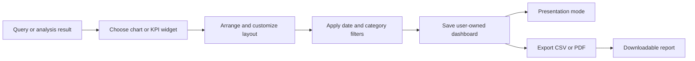

---

## 🔐 Architecture Decisions and Security Boundaries

### Why not query Neon directly with generated SQL?

Neon contains application records such as accounts and saved workspaces. Sending untrusted model-generated SQL to the application database would mix analytical exploration with sensitive application storage. QUANTARA instead runs constrained queries in an isolated DuckDB context containing the selected dataset only.

### Why separate AI from statistical ML?

A language model is useful for interpreting questions and drafting SQL, but its prose is not a substitute for numerical evaluation. The Python service computes anomalies, trends, and forecasts from actual observations; the UI labels predictions and measured values separately.

### Why is the browser not connected directly to the ML service?

The backend enforces identity, dataset ownership, request bounds, and private service authentication. The browser should not receive the ML service token or make privileged cross-service requests.

### Authentication and data boundaries

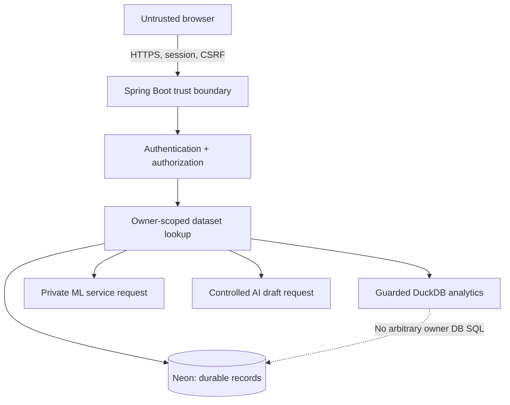

### Limits and operational safeguards

| Surface | Documented bound | Reason |
|---|---|---|
| Upload size | 5 MB | Limit parsing and storage pressure |
| Dataset rows | 10,000 | Bound interactive analysis |
| Dataset columns | 50 | Bound schema and UI complexity |
| Cell length | 10,000 characters | Avoid oversized individual values |
| Query output | 500 rows | Keep responses manageable |
| Query execution | 8 seconds | Cancel expensive queries |
| DuckDB query memory | 64 MB | Constrain analytical workload |
| ML input rows | 20–10,000 | Keep statistical requests bounded |
| Forecast horizon | Up to 60 periods | Avoid uncontrolled extrapolation |
| Missing periods | Up to 20% | Reject excessively sparse series |

> [!CAUTION]
> Resource limits reduce risk but are not a guarantee against every malicious or expensive workload. Verify behavior against the final deployed service.

---

## ☁️ Deployment Explained — From Laptop to Live Application

### Development topology

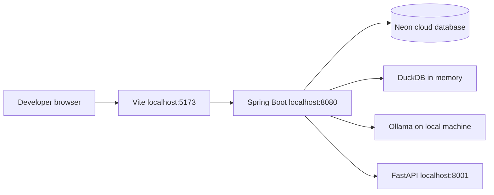

### Production topology and the AI hosting boundary

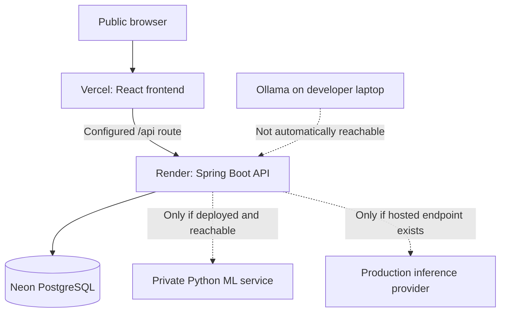

### What Vercel does

- Hosts the built React application and serves the landing page and dashboard assets.
- Handles frontend deployment from the configured Git repository.
- Needs a working production `/api` route or backend URL mapping.
- Does not automatically run the existing Java backend or the local Ollama model.

### What Render does

- Is the intended hosting platform for the Spring Boot backend and, if feasible, the separate Python service.
- Must be configured with an appropriate build/start process and runtime strategy.
- Needs secure environment variables for Neon and any service-to-service authentication.
- A validated `plan: free` configuration is **not** proof that the live service is healthy.
- Free instances may sleep or have memory, runtime, and availability limitations.

### What Neon does in production

- Provides the persistent PostgreSQL database accessible to the authorized backend.
- Stores application records independently of frontend redeployments.
- Requires securely configured connection details and controlled migrations.
- Must never have its password embedded in browser bundles, screenshots, or README examples.

### What happens to Ollama after deployment?

- The locally installed model stays on the developer's computer.
- Cloud services cannot assume that `localhost` refers to the developer's machine.
- Production AI requires a separately deployed model server or compatible hosted inference provider.
- If no free option satisfies the requirements, QUANTARA should disclose that AI features are limited rather than silently substitute fake responses.


## 📖 Reading the Repository Like an Engineer

| Start here | Learn this | Then inspect |
|---|---|---|
| `frontend/src/pages/` | What the user can do | Corresponding API calls in `frontend/src/services/` |
| `frontend/src/components/` | How screens are composed | Shared charts, tables, forms, and layout |
| `frontend/src/styles/` | How the visual identity stays consistent | Design tokens and global CSS |
| `frontend/e2e/` | Which browser journeys are covered | Assertions and test setup |
| `backend/src/main/` | How requests are validated and authorized | Controllers, services, repositories, configuration |
| `backend/src/test/` | How backend behavior is verified | Unit and integration tests |
| `ml-service/` | How numerical analysis is performed | API, model implementation, Python tests |
| `docs/api.md` | HTTP interface contracts | Endpoint inputs, outputs, error behavior |
| `docs/deployment.md` | How the system runs online | Runtime constraints and environment configuration |
| `docs/verification.md` | What has actually been tested | Evidence and outstanding limitations |

### Suggested order for a code review

1. Start at the React route for a user-facing feature.
2. Follow the typed request to its backend endpoint.
3. Identify where session identity and ownership are checked.
4. Inspect the service that implements the business operation.
5. Follow persistence or external-service calls.
6. Review the corresponding backend, Python, and browser tests.
7. Compare documented behavior with actual running behavior.

---


## 🏗️ System Architecture

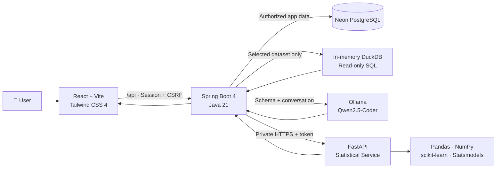

### Trust boundaries

- The browser never receives database passwords or the private ML service token.
- The backend verifies ownership **before** selecting a dataset for analysis.
- SQL runs against a fresh in-memory DuckDB table, **not** the privileged Neon connection.
- Model-generated SQL is treated as untrusted input and must pass validation.
- ML output is computed from supplied observations; LLM prose is not substituted for statistical results.

---

## 🔄 How QUANTARA Works

### Dataset → question → insight

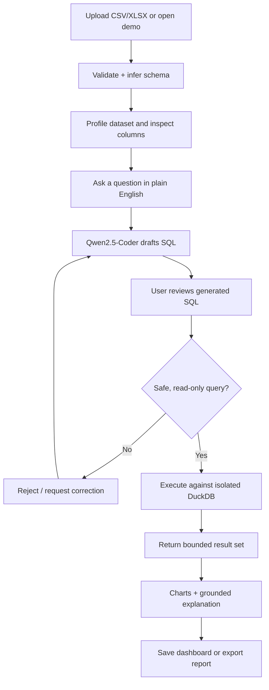

### Statistical analysis

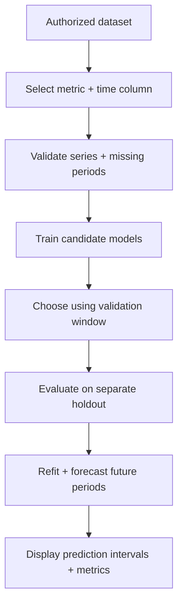

---

## 📁 Project Structure

```mermaid
flowchart TD
    ROOT["🗄️ QUANTARA<br/>AI-Powered Analytics Platform"]

    ROOT --> FE["🎨 frontend/<br/>React 19 + Vite + TypeScript"]
    ROOT --> BE["☕ backend/<br/>Java 21 + Spring Boot 4"]
    ROOT --> ML["🐍 ml-service/<br/>Python + FastAPI"]
    ROOT --> DOC["📚 docs/<br/>Technical Documentation"]
    ROOT --> CI["⚙️ .github/workflows/<br/>GitHub Actions"]
    ROOT --> DEP["☁️ Deployment Files"]

    FE --> FP["📄 src/pages/<br/>Application Screens"]
    FE --> FC["🧩 src/components/<br/>Reusable UI Components"]
    FE --> FS["🔗 src/services/<br/>Backend API Integration"]
    FE --> FH["🪝 src/hooks/<br/>Custom React Hooks"]
    FE --> FX["🌐 src/context/<br/>Shared Application State"]
    FE --> FST["🎨 src/styles/<br/>Global Styling"]
    FE --> FA["🖼️ src/assets/<br/>Images and Icons"]
    FE --> FT["🧪 e2e/<br/>Playwright Tests"]

    FP --> P1["Overview + Datasets"]
    FP --> P2["AI Copilot + SQL Workspace"]
    FP --> P3["Statistical Analytics + Dashboards"]
    FP --> P4["Reports + Activity + Settings"]

    BE --> BJ["📂 src/main/java/<br/>Java Application Code"]
    BE --> BR["📂 src/main/resources/<br/>Configuration + Migrations"]
    BE --> BT["🧪 src/test/<br/>Backend Tests"]

    BJ --> BC["Controllers<br/>REST API Endpoints"]
    BJ --> BS["Services<br/>Business Logic"]
    BJ --> BDB["Repositories<br/>Database Access"]
    BJ --> BSEC["Security<br/>Authentication + CSRF"]
    BJ --> BSQL["Analytics<br/>SQL Validation + DuckDB"]

    ML --> M1["FastAPI<br/>Analytics Endpoints"]
    ML --> M2["scikit-learn<br/>Anomaly Detection"]
    ML --> M3["Statsmodels<br/>Time-Series Forecasting"]
    ML --> M4["Pandas + NumPy<br/>Data Processing"]

    DOC --> D1["Architecture + API Guides"]
    DOC --> D2["Deployment + Testing Guides"]

    DEP --> V["Vercel<br/>Frontend Hosting"]
    DEP --> R["render.yaml<br/>Render Configuration"]
    DEP --> C["compose.yaml<br/>Optional Local Orchestration"]
    DEP --> G[".gitignore<br/>Git Exclusions"]

    classDef root fill:#173D32,color:#FFFFFF,stroke:#173D32,stroke-width:3px
    classDef main fill:#DCEDE3,color:#173D32,stroke:#7DA58C,stroke-width:2px
    classDef child fill:#F5F8F2,color:#173D32,stroke:#A8C3AE

    class ROOT root
    class FE,BE,ML,DOC,CI,DEP main
    class FP,FC,FS,FH,FX,FST,FA,FT,BJ,BR,BT,M1,M2,M3,M4,D1,D2,V,R,C,G child
```

---

## 💻 Getting Started

### Prerequisites

| Tool | Version / Notes |
|---|---|
| Java | **21** |
| Node.js | **22+** |
| Python | **3.14**, as used in the current local instructions |
| PostgreSQL | Existing **Neon** database |
| Ollama | Installed and running for local AI |
| Git | For cloning and version control |

### 1. Clone the repository

```bash
git clone https://github.com/rutvilandge/Quantara.git
cd Quantara
```

### 2. Install frontend dependencies

```powershell
cd frontend
npm.cmd ci
cd ..
```

### 3. Set up the Python analytics service

```powershell
cd ml-service
python -m venv .venv
.\.venv\Scripts\python.exe -m pip install -r requirements-dev.txt
cd ..
```

### 4. Prepare the local AI model

```powershell
ollama pull qwen2.5-coder:3b
```

Keep Ollama running while using the AI Copilot.

### 5. Start Spring Boot

```powershell
cd backend
.\start-local.ps1 -DatabaseUrl 'jdbc:postgresql://YOUR_NEON_HOST/neondb?sslmode=require&channelBinding=require' -DatabaseUsername neondb_owner
```

The launcher requests the Neon password via a **hidden prompt**. It passes credentials to its child process, starts the local Python service on `127.0.0.1:8001` when the environment exists, creates a session-specific shared ML token, and stops its Python child when the launcher exits.

> [!CAUTION]
> Never paste real database passwords, API keys, or tokens into README files, screenshots, Git commits, or public issues.

### 6. Start the frontend

In a separate terminal:

```powershell
cd frontend
npm.cmd run dev
```

Open **`http://localhost:5173`**, create an account, then upload a dataset or choose **Explore E-commerce demo**.

### Local service endpoints

| Service | Address | Notes |
|---|---|---|
| Frontend | `http://localhost:5173` | Local Vite application |
| Spring Boot | `http://localhost:8080` | Primary API |
| Health | `http://localhost:8080/actuator/health` | Public health endpoint |
| CSRF bootstrap | `http://localhost:8080/api/auth/csrf` | Obtain CSRF token |
| Python ML | `http://127.0.0.1:8001` | Private service; not a public browser API |

---

## 🧠 AI and Statistical Analytics

**Two different systems, two different responsibilities:**

| | AI Copilot | Statistical Engine |
|---|---|---|
| **Technology** | Ollama + Qwen2.5-Coder | FastAPI + scikit-learn + Statsmodels |
| **Input** | Question, schema, conversation | Validated numerical/time-series observations |
| **Output** | SQL draft, explanation, chart suggestions | Anomalies, trends, forecasts, evaluation metrics |
| **Primary safeguard** | SQL review and read-only execution | Holdout evaluation and explicit uncertainty |

### Responsible interpretation

- Forecasts remain separate from original observations.
- Missing periods may be interpolated for modeling, but displayed actuals remain visibly missing.
- Model selection uses an earlier validation window; final metrics use a separate trailing holdout.
- Metrics include **MAE, RMSE, sMAPE, baseline MAE, and empirical interval coverage**.
- Anomaly flags indicate unusual data points, **not proof of fraud or causality**.
- A 95% prediction interval is model-dependent and is **not a guarantee**.

---

## 🔐 Security and Limits

| Area | Guardrail |
|---|---|
| **Uploads** | 5 MB; 10,000 rows; 50 columns; 10,000 characters per cell; first XLSX sheet |
| **SQL** | Single SELECT/WITH statement; max 500 returned rows; 8-second cancellation |
| **Query execution** | Bounded concurrency; external readers/extensions disabled; 64 MB DuckDB/query |
| **ML** | 20–10,000 input rows; 20–2,000 aggregated periods; max 60-period horizon |
| **Missing periods** | At most 20% for the statistical workflow |
| **Authentication** | BCrypt passwords; HttpOnly sessions; HTTPS required for production sessions |
| **Mutations** | CSRF protection, including signup and login |
| **API controls** | Explicit CORS allowlists, validation, per-process fixed-window limits |
| **Database changes** | Versioned Flyway migrations; existing history preserved; clean disabled |

**Rate-limit note:** Fixed-window limits are per application process and reset when it restarts. This is not distributed rate limiting.

---

## 🧪 Testing and Verification

```powershell
# Backend tests
cd backend
.\mvnw.cmd -B verify

# Python statistical tests
cd ..\ml-service
.\.venv\Scripts\python.exe -m pytest -q

# Frontend build and lint
cd ..\frontend
npm.cmd run build
npm.cmd run lint

# With frontend, backend, ML service, and Ollama running:
npx.cmd playwright test
```

Browser tests exercise actual APIs with unique test accounts and do not delete pre-existing database data. Unit tests do not require production credentials. The optional full-context database test runs only when `DATABASE_PASSWORD` is provided.


## ☁️ Deployment

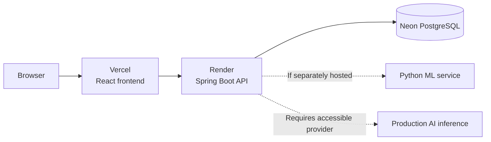

| Component | Planned host | Reality check |
|---|---|---|
| Frontend | **Vercel Hobby** | Requires successful production build and environment configuration |
| Spring Boot API | **Render Free** | Free configuration was validated; live service still needs confirmation |
| Database | **Neon Free** | Configure credentials securely; check production connection |
| Python ML | **Separate accessible service** | Not available online merely because it runs locally |
| AI inference | **Hosted model endpoint** | Local Ollama is not automatically reachable from cloud services |

**Frontend workspace:** [quantara-neon.vercel.app/app](https://quantara-neon.vercel.app/app) — user-provided URL; live end-to-end functionality not independently verified.  
**Backend API:** _Add the verified production endpoint when available._

Free services may sleep, impose usage quotas, or lack the resources for full production AI/ML workloads. See the detailed [deployment guide](docs/deployment.md) for the intended setup and constraints.

---

## 📚 Documentation

| Document | Contents |
|---|---|
| [`docs/deployment.md`](docs/deployment.md) | Hosting, configuration, free-tier constraints |
| [`docs/api.md`](docs/api.md) | API endpoints and request contracts |
| [`docs/design-system.md`](docs/design-system.md) | Forest-and-sage visual language and components |
| [`docs/verification.md`](docs/verification.md) | Testing scope and verification evidence |

---


### ✦ From raw data to meaningful direction.

**QUANTARA** · Built to make analytics more accessible, interactive, and explainable.

**Developed by [Rutvi Landge](https://github.com/rutvilandge)**

</div>

